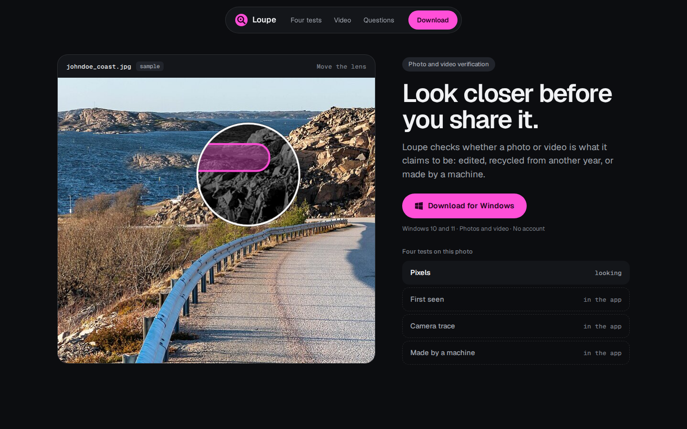
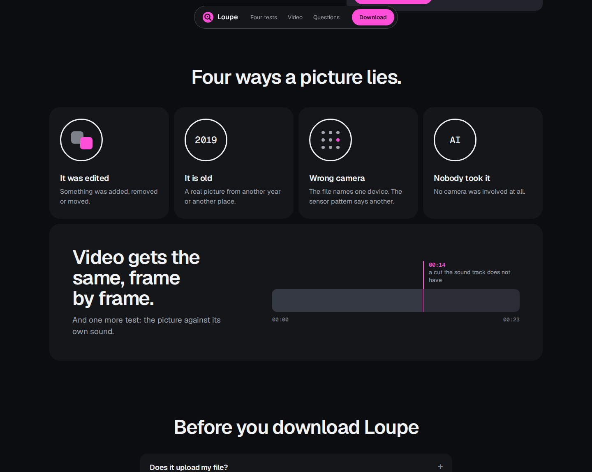
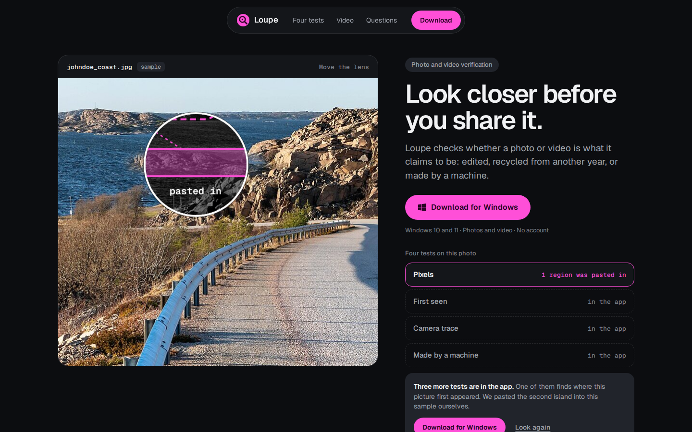

<h1 align="center">Loupe: OSINT photo and video verification</h1>

<b>Look closer before you share it.</b> Find out whether a photo or video was edited, recycled or generated.

OSINT · OSINT tool · image verification · image forensics · fact checking · deepfake detection · reverse image search · windows

> **Status: v2.1.0.** The app is out — [download Loupe for Windows](https://awesomeosint.tools/loupe/).

## Why this exists

A screenshot is evidence until it is not. Edited, recycled from another year, or made by a machine — each of those has tells, if you know where to look.

## Why it is different

One tool checks one thing. Loupe runs the whole bench: error-level analysis, noise patterns, reverse search and AI artefacts — and says which finding points where.

## The idea

- **One object.** A loupe: a round lens you put on a picture.
- **One number.** Four tests.
- **Colour.** Viewing-room black `#0C0D10` and white. Marker magenta `#FF4FD8` is the part of a picture that does not belong, and the download.
- **The main feature.** It shows where: not a score, but the region that was pasted in, the place it was copied from, and the date the picture first appeared.

## The demo on the page

A lens glides across the photo by itself and stops on an island in the bay. Outside the lens the picture looks as it was posted; under it the picture is magnified and grey, the island is marked as pasted in, and a dashed outline shows the island it was copied from. The first of four tests then reads "1 region was pasted in", the other three stay "in the app", and the download is offered. After that the lens follows the pointer, so the visitor can look around.

## Credits

The photo in the demo is [Main road in Ramsvik](https://commons.wikimedia.org/wiki/File:Main_road_in_Ramsvik.jpg) by W.carter, from Wikimedia Commons, released under CC0 (public domain). It is cropped, and a copy of the island on the left was pasted into the bay for this demo: that paste is the edit the lens points at.

There are no reviews or user counts on the page. Add real ones when you have them.

Fonts in `assets/fonts` are Geist (the page typeface), Geist Mono and Inter, all under the SIL Open Font License; the licence texts sit next to them.
